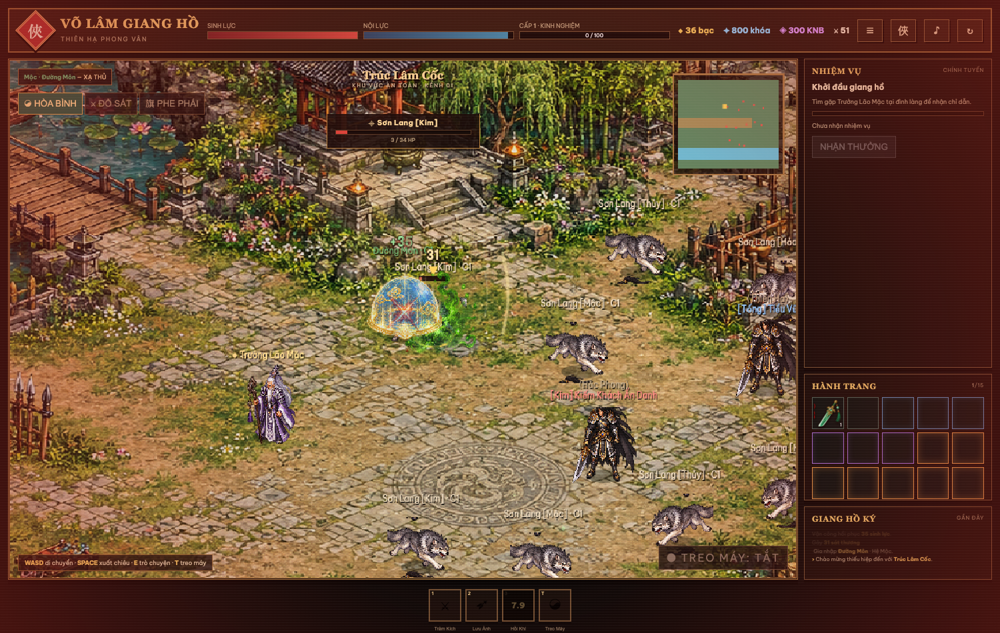

# ⚔️ Võ Lâm Giang Hồ

Game nhập vai võ hiệp 2D chạy trực tiếp trên trình duyệt — **không cần cài đặt**.

## 🎮 Chơi ngay

👉 **https://khangcoi186.github.io/vo-lam-giang-ho/**

## ✨ Tính năng

- **6 môn phái**: Thiếu Lâm, Thiên Vương, Đường Môn, Ngũ Độc, Nga My, Thúy Yên — mỗi phái có chỉ số, tầm đánh, hiệu ứng và nội tại riêng.
- **Ngũ hành tương khắc**: đánh đúng hệ khắc gây thêm 35% sát thương, đối đầu hệ kỵ nhận thêm 30%.
- **Chiến đấu hành động**: di chuyển tự do, chọn mục tiêu, bạo kích, trạng thái Choáng / Trúng độc / Đóng băng / Suy yếu.
- **Treo máy tự chiến** và hệ thống PK: Hòa Bình · Đồ Sát · Phe Phái, chữ đỏ, rơi đồ khi tử vong.
- **Nhiệm vụ chính tuyến**, hành trang, rơi đồ, cường hóa trang bị, khảm ngọc ngũ hành.
- **Hệ thống phát triển**: Tu vi, Kinh mạch, Tọa kỵ, Linh thú, Cánh.
- **Kho báu, kinh tế, hoạt động, VIP** (mô phỏng — không có giao dịch tiền thật).
- **Hiệu ứng & âm thanh**: số sát thương bay lên, rung màn hình, vệt chém, đèn lồng, đom đóm, sóng nước, SFX tổng hợp bằng Web Audio.
- **Tự lưu tiến trình** vào trình duyệt (localStorage).

## 🕹️ Điều khiển

| Phím | Hành động |
| --- | --- |
| `WASD` / phím mũi tên | Di chuyển |
| `Space` / `1` | Xuất chiêu |
| `2` | Lưu Ảnh Bộ (lướt) |
| `3` | Hồi Khí |
| `Tab` | Chọn mục tiêu gần nhất |
| `E` | Trò chuyện với NPC |
| `T` | Bật / tắt treo máy |
| Click chuột | Chọn mục tiêu / mở hội thoại |

Trên điện thoại có D-pad và nút đánh cảm ứng.

## 🛠️ Công nghệ

HTML + CSS + JavaScript thuần, canvas 2D, không framework, không build step. Toàn bộ game nằm trong `index.html` và 7 sprite atlas PNG.

## 📄 Ghi chú

Đây là bản prototype phục vụ học tập và giải trí. Các hệ thống KNB/VIP chỉ mang tính mô phỏng, không có nạp tiền hay giao dịch thật.
